<samp>
  <a href="https://doshi-harsh.github.io">website</a> ·
  <a href="#-how-i-can-help">help</a> ·
  <a href="#-toolkit">toolkit</a> ·
  <a href="#-lets-talk">contact</a>
</samp>

 

I lead and advise engineering teams. Hands-on, I work on the plumbing that gets software from a commit to production: **CI/CD, cloud, Linux packaging and vulnerability management.** For leaders, I help with hiring, product direction and technical due diligence. I also have project management experience.

> 🔭 **Currently:** leading hands-on engineering work: pipelines, Kubernetes and vulnerability workflows that actually get closed
> 💬 **Ask me about:** hiring and team design, delivery planning, release automation, CVE triage, due diligence
> 📍 **Based in:** Ottawa, Canada · certified Scrum Master

## 🎯 How I can help

<b>Seven ways I unblock teams</b>

 

| | |
| --- | --- |
| 🧭 **Advise leaders** | Technical due diligence, hiring and team design, product and roadmap direction, project planning and costing |
| ⚙️ **Automate delivery** | CI/CD, scheduled jobs and release automation that make every build repeatable |
| ☁️ **Build on the cloud** | Kubernetes, containers and infrastructure as code on AWS, Azure and GCP |
| 🛡️ **Secure what you ship** | Vulnerability scanning, triage and reporting; certificates and identity |
| 🐧 **Work with Linux** | Debian packaging, repositories and reproducible image builds |
| ✅ **Test with confidence** | Automated testing and reports people actually read |
| 🤝 **Lead and unblock** | Agile delivery, code review and mentoring |

## 🧰 Toolkit

<b>What I reach for</b>

 

**Delivery** &nbsp;

**Platforms** &nbsp;

**Linux** &nbsp;

**Code** &nbsp;

## 📈 Track record

<b>Selected results (click to expand)</b>

 

- 🧭 Worked as a senior engineer and project manager at a software and digital marketing company: client projects, status reporting, agile workflow, hosting and cloud.
- 🧱 Broke a monolithic web application into containerised microservices on Kubernetes, improving developer workflow and scalability.
- 🚀 Built automated deployment pipelines with Git hooks, webhooks and PowerShell, with deployment logs posted to Slack.
- ☁️ Moved client applications from VPS hosting to AWS and Google Cloud.
- 🔐 Administered Azure: AKS, Key Vault, service principals and custom permission models.
- 🧪 Built automated and stress testing for a telecom-grade security product.
- 🛡️ Ran CVE scanning, triage, mitigation and publishing for a Linux distribution.

## 📬 Let's talk

Pipeline that keeps breaking? Release process too slow? Security backlog nobody owns?

**[✉️ Email me](mailto:me@iamharshdoshi.com?subject=Consultation%20enquiry)** with three things: what is blocking you, your stack, and your timeline. I reply within a day, and I'm happy to jump on a call. I'll tell you honestly whether and how I can help.

🌐 <a href="https://doshi-harsh.github.io">doshi-harsh.github.io</a> · 📍 Ottawa, Ontario

